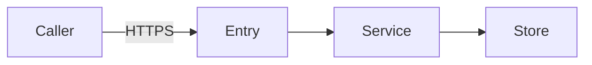

# AWS design — component or feature name

Copy this file, replace every line in italics, and delete what does not apply with a sentence saying why. No client name, account ID, ARN, address or real resource name appears anywhere in it.

## Requirements

| Requirement | Value | Source |
|---|---|---|
| Main paths | *what the workload does* | *issue or person* |
| Load and its shape | *requests or events per second, steady or spiky; "not stated" if assumed* | |
| Latency | *the percentile and the target* | |
| Outage tolerance | *recovery time and data loss the project accepts* | |
| Data held | *categories; personal, payment or regulated?* | |
| Where data may live | *Region constraint and why* | |
| Budget | *monthly amount* | |

## Flows

*One line per flow: from, to, synchronous or not, what it carries.*

## Services

| Problem | Service | Why | Alternative considered | Departs from docs/services.md? |
|---|---|---|---|---|
| *compute* | | | | *no, or the decision record* |

## Identity

| Component | Role | Actions | Resources | Condition keys |
|---|---|---|---|---|

*How people and any third party reach it.*

## Network

*Subnets per tier, security group references, endpoints, NAT placement, how an operator reaches an instance.*

## Data protection and exposure

| Store or listener | Encryption at rest | In transit | Key | Secret source |
|---|---|---|---|---|

*For each component: the layer that calls AWS, what it returns to its caller when an AWS call fails, and the named fields it logs.*

## Cost

| Item | Value |
|---|---|
| Owner tag key | |
| Budget and forecast alert | |
| Log retention | |
| Estimate | *monthly amount, Region, date, assumptions* |

## Well-Architected pass

| Pillar | Decision and trade-off |
|---|---|
| Operational excellence | |
| Security | |
| Reliability | |
| Performance efficiency | |
| Cost optimization | |
| Sustainability | |

## Decisions recorded

*Links to the decision records this design produced.*

## Open questions

*Each question, and who answers it.*
